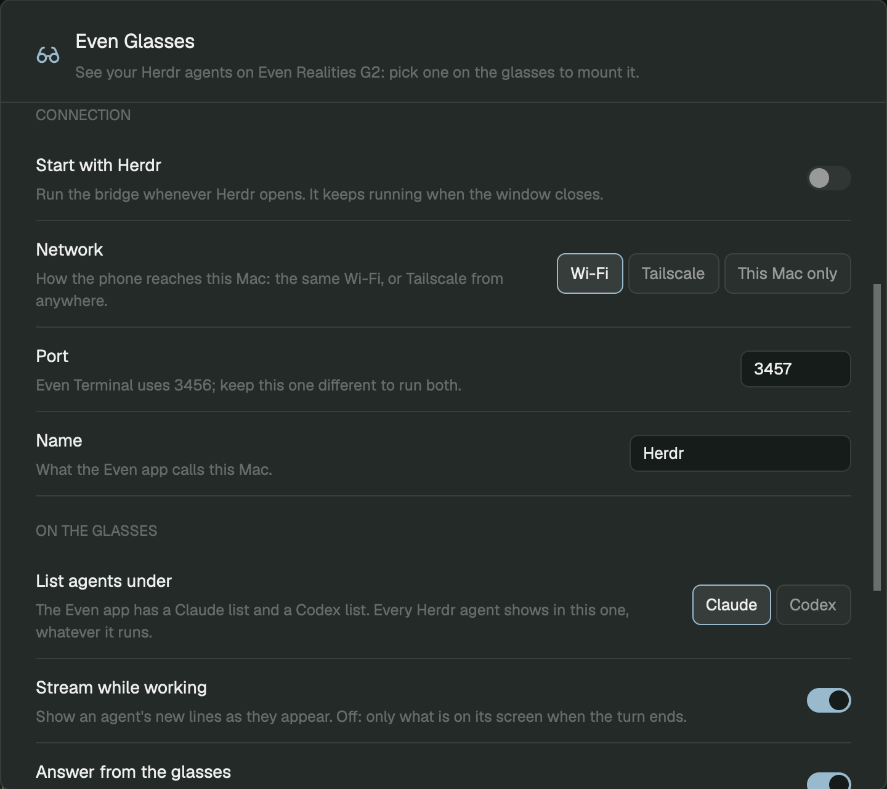

# even-herdr

See and drive your [Herdr](https://github.com/herdrdev/herdr-app) agents from Even Realities G2 glasses.



The Even app lists every active Herdr agent. Pick one on the glasses to mount it: its output streams to the display, what you say or tap is typed into its terminal, and when it stops to ask a yes/no you can answer from the ring. Herdr gets an **Even Glasses** settings dialog to run, pair and tune it.

## How it works

The Even app normally talks to [`even-terminal`](https://www.npmjs.com/package/@evenrealities/even-terminal), which runs its own Claude or Codex sessions. This mod ships a small bridge that speaks the same API but answers it from herdr-core (`hc`), so the sessions the app sees are the agents already running in Herdr, whatever program they are.

```
G2 + R1  <-BLE->  Even app  <-Wi-Fi / Tailscale->  bridge.mjs  <-hc->  your Herdr agents
```

## Requirements

- Herdr 0.1.15 or newer with herdr-core (`hc`), on macOS
- Node.js 18 or newer
- Even Realities G2 paired with the Even app
- Optional: `npm install -g @evenrealities/even-terminal` for the pairing QR (without it, use Copy link)

## Install

Ask your agent to add `github.com/reeeeeee-dev/even-herdr` to Herdr, or do it by hand:

1. Copy `mods/even-glasses/` to `~/.config/herdr-app/mods/even-glasses/`.
2. Merge `keys.json` into `~/.config/herdr-app/keys.json` (`cmd-shift-g` opens the dialog).
3. For the sidebar row, add this block to your layout's sidebar column, above the footer. Shipped layouts are rewritten on start, so do this in your own (cloned) layout:

   ```json
   { "id": "even-glasses", "type": "block", "content": { "mod": "even-glasses", "props": { "row": true } }, "size": { "px": 34 } }
   ```

4. `herdr-app check ~/.config/herdr-app/mods/even-glasses`

## Use

1. Open **Even Glasses** (the sidebar row, `cmd-shift-g`, or `herdr-app do mod.open --name even-glasses`) and press **Start**.
2. Press **Show code** and scan it in the Even app where you would add an Even Terminal. Phone and Mac must be on the same Wi-Fi, or both on Tailscale with Network set to Tailscale.
3. On the glasses, open the session list and pick an agent.

Turn on **Start with Herdr** to have the bridge running whenever Herdr is open.

## What it touches

- **Network:** the bridge listens on your LAN or Tailscale address and on 127.0.0.1, port 3457 by default. Every request needs the pairing token.
- **Programs:** the mod runs `node` and `hc`; the bridge runs `hc` (`ls`, `read`, `send`, `keys`, `interrupt`) and `herdr-app do tab.new`.
- **Files:** settings and the token live in `~/.config/herdr-app/even-glasses.json` (mode 600), outside the mod's folder.

Anyone holding the token can read your agents' screens and type into them. Keep the QR private and use **New token** if it leaks.

## Limits

- Developed against the Even Terminal 0.10.5 API and verified with a simulated client; treat pairing with real glasses as untested until you have tried it.
- A terminal is a screen, not a transcript: text an agent rewrites in place can show twice or be skipped.
- Yes/No from the glasses presses Enter/Esc in the agent's terminal; it does not pick among several options.
- The Even app only has Claude and Codex lists; all agents appear under the one you choose.
- This is a dialog, not a tab inside Herdr's Settings window, because mods cannot add Settings sections yet: [herdrdev/herdr-app#987](https://github.com/herdrdev/herdr-app/issues/987).

`RECIPE.md` is the brief another agent can rebuild this mod from.
