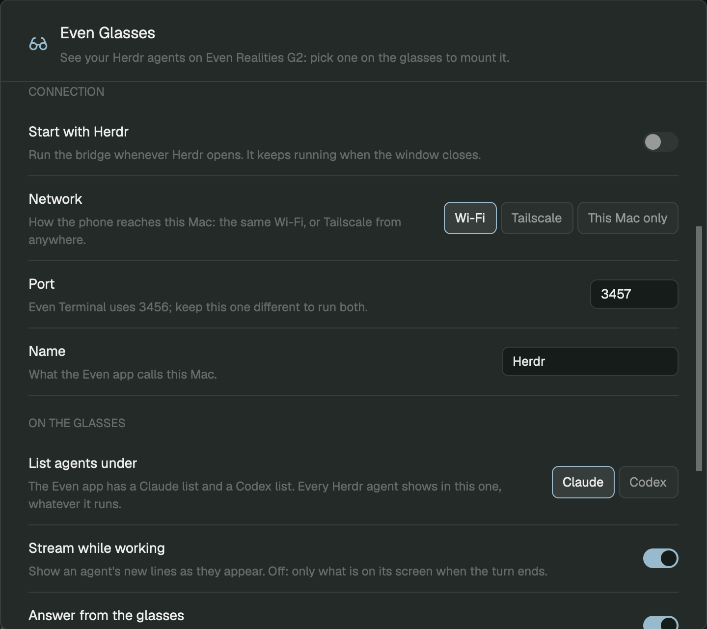

# Even Glasses

A settings page and a small bridge that put Herdr's agents on Even Realities G2 glasses. On the glasses you get a list of every active agent; pick one to mount it, watch its output arrive, talk or tap to prompt it, and answer its yes/no questions. In Herdr you get a sidebar row and a dialog, drawn like Herdr's own Settings, to run, pair and tune it.

**What you see**

- **Sidebar row** (34px tall, above the Settings row): a glasses icon (14px), the label "Even Glasses" in the muted text color, and a 6px dot on the right while the bridge runs: the `done` color when idle, the `working` color while glasses are mounted on an agent. On the narrow sidebar rail only the icon shows, with a tooltip.
- **Dialog** (720px wide, 640px tall): a header with the icon in the accent color, the title "Even Glasses" (16px semibold) and one line of what it does; below it one scrolling page with an always-visible scrollbar. Rows are a title (14px) and a dim explanation (12.5px) on the left and one control on the right, separated by 1px borders, with small uppercase section headings.
  1. **Status card**: a 9px dot, "Running at `<address>:<port>`" or "Stopped", a second line ("2 agents listed. Glasses are on t3h." / "No glasses connected." / the error in the `blocked` color), and a Start/Stop button.
  2. **Pair**: "Pairing code" with Copy link and Show code (a QR on a white rounded card, hidden until asked for because it holds the token); "Token" showing only its first and last four characters, with New token.
  3. **Connection**: Start with Herdr (switch), Network (Wi-Fi / Tailscale / This Mac only), Port (text field), Name (text field).
  4. **On the glasses**: List agents under (Claude / Codex), Stream while working (switch), Answer from the glasses (switch), New agent from the glasses (Off or one of the installed agents), Lines when mounting (stepper, 10 to 200 by 10).
  5. **Active agents**: one row per live agent: a status dot in that status's theme color, "space / tab", the program's name, and an "on glasses" badge on the mounted one.
- **On the glasses** (drawn by the Even app, not by this mod): the session list holds one entry per agent, titled "`<space / tab>` · `<agent>`", agents that need you first (prefixed `!`), then working ones, then the rest.

**How it behaves**

- Clicking the sidebar row, or `cmd-shift-g`, opens the dialog; Esc closes it. Clicking an agent row focuses that agent.
- Every control saves at once to `even-glasses.json`. Text fields save on Enter or when they lose focus; an invalid port is refused with a toast and the field goes back. Changing the port or network while the bridge runs restarts it.
- Start runs the bridge in an hc terminal named `even-glasses`, so it keeps running when the window closes; Stop kills and removes it. With Start with Herdr on, the sidebar row starts it when Herdr opens.
- Agent status maps to what the Even app shows: `working` is busy, `blocked` is awaiting, `done` and `idle` are idle.
- Mounting an agent sends the last N lines of its screen once, then (with streaming on) each new line as it appears. Lines that only tick in place (spinners, timers, percentages, token counts) are not resent. When the turn ends the glasses get a result and idle.
- A prompt from the glasses is typed into the mounted agent's terminal. With no agent mounted it opens a new Herdr tab running the chosen agent with that prompt, or is refused when that setting is Off.
- When a mounted agent blocks, the glasses get a Yes/No question: Yes presses Enter in its terminal, No presses Esc. With Answer from the glasses off, they get a notification instead. Interrupt from the glasses is `hc interrupt`.

**Built from**

- `mods/even-glasses/main.js`: one `View` with two roles. In a layout block with props `{ "row": true }` it is the sidebar row; opened with `mod.open` it is the dialog (`mod.json`: `{ "place": "none", "overlay": { "kind": "dialog", "width": 720 } }`).
- Layout: a block `{ "id": "even-glasses", "type": "block", "content": { "mod": "even-glasses", "props": { "row": true } }, "size": { "px": 34 } }` in the sidebar column, just above the footer.
- `keys.json`: `"cmd-shift-g": "mod.open:even-glasses"` in `global`.
- `herdr` functions: `exec` (find and run Node), `hc` (`run --bg --no-parent --name even-glasses`, `wait --timeout 1`, `read`, `kill`, `rm`), `fetch` (the bridge's `/api/bridge` on 127.0.0.1), `readTextFile` / `writeTextFile` (the settings file, read-compare-write), `agents`, `knownAgents`, `layout`, `theme`, `notify`, `run` (`mod.open`, `agent.focus`), `props`, `closeOverlay`, `appHome`, `checking`; `cx.write_to_clipboard` for Copy link.
- `mods/even-glasses/bridge.mjs`: a dependency-free Node (18+) HTTP server that speaks the API the Even app uses with `even-terminal`: token auth (Bearer or `?token=`), `GET /api/info`, `/api/sessions`, `/api/sessions/:id/history`, `/api/status`, `/api/messages`, `/api/events` (SSE), `/api/update-check`, `/api/metrics`, and `POST /api/prompt`, `/api/interrupt`, `/api/permission-response`, `/api/question-response`; plus `GET /api/bridge` for the dialog. It answers from `hc ls --json`, `hc read --json`, `hc send`, `hc keys`, `hc interrupt` and `herdr-app do tab.new`. Commands: `serve`, `info` (creates the settings, prints them with the pairing URL and QR matrix as JSON), `rotate` (new token).
- Settings: `<herdr-app home>/even-glasses.json`, mode 600: `autostart`, `port` (3457), `network` (`lan` | `tailscale` | `loopback`), `name`, `provider` (`claude` | `codex`), `token`, `stream`, `answer`, `new_agent`, `history_lines` (40), `poll_ms` (1000).
- Pairing URL: `http://<address>:<port>?token=<token>&defaultProvider=<provider>&name=<name>`, the form the Even app scans. The QR comes from the encoder `even-terminal` ships (`qrcode-terminal`); the dialog draws it as black and white rectangles, one per run of same-colored cells.
- Art: `glasses.svg`, a 24px stroke icon.

**Watch out**

- Herdr's `exec` has no shell PATH: Node installed by nvm or fnm is only found by asking the interactive shell (`$SHELL -ilc "command -v node"`). The bridge also adds Node's folder, `~/.local/bin` and the Homebrew folders to its own PATH so it finds `hc`, `herdr-app` and `even-terminal`.
- `hc ls` gives every program an `agent` name; an agent is a terminal that reports a `status`. Filter on that or the bridge lists itself.
- Strip `HC_TERMINAL_ID` from the environment before calling `hc send`: with it set, hc wraps the text in `<hc from=…>` and agents read it as a note from another agent.
- `hc wait --output` only matches text printed after the wait starts, so it can miss a fast startup. Probe `/api/bridge` and use a one-second `hc wait` as the pause between tries (mods have no `setTimeout`).
- `writeTextFile` replaces the file and can loosen its mode; the bridge sets 600 again on every `info`.
- Do not write generated files into the mod's folder: saving anything there reloads the mod. The QR is drawn, not saved as an image.
- The Even app accepts only the providers `claude`, `claude-sync` and `codex`. All agents are listed under the chosen one; the other list stays empty.
- A terminal is a screen, not a transcript: streaming sends lines the bridge has not seen before, so text an agent rewrites in place can appear twice or be skipped. Yes/No presses Enter/Esc, which fits agents' usual dialogs but is not a per-option answer.
- The QR needs `even-terminal` installed (`npm install -g @evenrealities/even-terminal`); without it, pair with Copy link.
- The settings page is a dialog, not a tab inside Herdr's Settings window: `frame/settings` is rewritten on every start and has a fixed section list (herdrdev/herdr-app#987).
- Built against Herdr 0.1.15, herdr-core 0.1.21 and the Even Terminal 0.10.5 API, on macOS.

**Done when**

- `herdr-app check mods/even-glasses` passes and `herdr-app status` shows no errors.
- The sidebar row opens the dialog; toggling Start with Herdr flips `autostart` in `even-glasses.json` and the file stays mode 600.
- Start makes a live hc terminal named `even-glasses` and the card reads "Running at …"; Stop removes it.
- With the token, `GET /api/sessions` lists exactly the live agents and not the bridge; without it every `/api` route answers 401.
- Reading `/api/events?sessionId=<agent>` while that agent works yields `status: busy`, `text_delta` lines, then `result` and `status: idle`; `POST /api/prompt` with that session types the text into its terminal.
- Show code draws a QR that the Even app scans to the same address and token.
